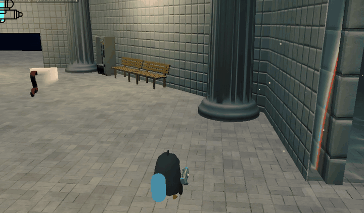
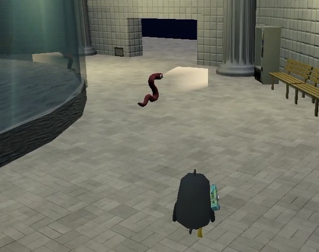
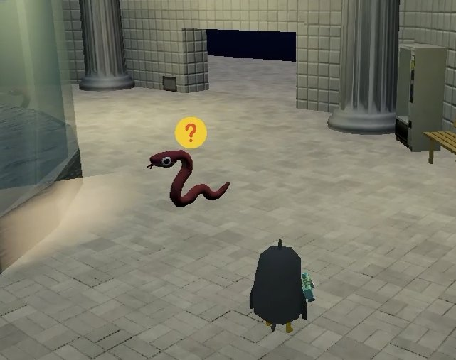
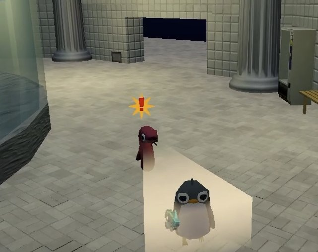
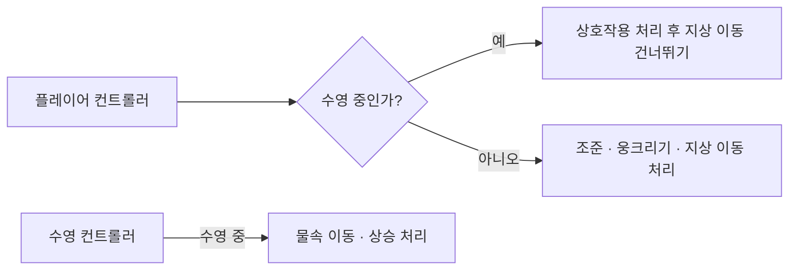

# PENQUA
## 플레이 화면

| 순찰 | 의심 (?) | 경계 (!) |
|---|---|---|
|  |  |  |

경비원은 순찰·의심·경계·추격·복귀 5개 상태로 움직입니다. 발소리를 들으면 의심 아이콘을 띄우고 소리 난 곳으로 향하고, 시야에 플레이어가 들어오면 경계 아이콘과 함께 몸을 돌립니다. 두 감지가 동시에 일어나면 시야 감지가 우선합니다.

### 주요 코드
- `Scripts/Guard/GuardPatrol.cs` — 경비원 상태 전환과 감지
- `Scripts/Player/SwimController.cs` — 플레이어 이동에서 분리한 수영 처리

> 이 저장소에는 씬과 에셋이 포함되어 있지 않아 단독으로 실행되지 않습니다. 실행 화면은 위 GIF로 대신합니다.

물총을 든 펭귄이 경비원을 피해 시설 안을 돌아다니는 3D 잠입 액션 게임입니다. 물은 펭귄이 헤엄칠 수 있는 공간인 동시에 경비원의 움직임을 늦추는 수단입니다.

| 개발 기간 | 인원과 역할 | 기술 | 진행 상태 |
| --- | --- | --- | --- |
| 2025.11 ~ | 1인 · 게임 기획 및 클라이언트 개발 | Unity 6 · C# | 개발 중 |

개발 중인 게임에서 발췌한 C# 코드입니다. 씬과 에셋이 필요한 전체 게임은 이 저장소만으로 실행할 수 없습니다.

## 경비원 감지 반응 시연

경비원은 소리를 감지하면 경계 반응(물음표)을, 플레이어를 시야에서 발견하면 발견 반응(느낌표)을 표시합니다. 두 감지가 겹칠 때는 시야 감지를 우선하도록 규칙을 두었습니다. GIF는 반응의 전환을 보여주는 장면이며, 동시 감지 우선순위의 별도 테스트 영상은 아닙니다.

## 플레이와 주요 기능

- **이동** — 지상에서는 걷기와 조준 이동을 하고, 웅덩이에서는 미끄러지며, 물속에서는 헤엄칩니다.
- **물총** — 경비원을 조준해 물을 뿌립니다. 젖은 정도에 따라 경비원의 움직임이 달라집니다.
- **경비원** — 순찰하다가 플레이어를 발견하면 경계하고 추격합니다.

## 코드 구조

| 플레이 중 일어나는 일 | 담당 코드 |
| --- | --- |
| 펭귄이 조준하고 물을 쏜다 | [WaterGunController](Scripts/Player/WaterGunController.cs) |
| 경비원이 순찰하거나 추격하고 젖은 정도에 따라 속도가 변한다 | [GuardPatrol](Scripts/Guard/GuardPatrol.cs) |
| 펭귄이 물에 들어가 헤엄친다 | [SwimController](Scripts/Player/SwimController.cs) |

## 개발 사례 · 수영 중에도 주변 물체와 상호작용하려면

걷기, 조준 이동, 웅덩이에서 미끄러지기, 수영을 하나씩 구현하면서 같은 이동 함수에 조건을 붙였습니다. 나중에는 수영 동작 하나를 고치려고 해도 걷기와 조준 조건까지 다시 읽어야 했습니다.

수영을 분리할 때 가장 고민한 건 기존 플레이어 컨트롤러에 무엇을 남길지였습니다. 물속에서는 지상 이동과 웅크리기를 처리할 필요가 없지만 주변 물체와 상호작용할 수는 있어야 했습니다.

- 기존 플레이어 컨트롤러는 수영 중이면 상호작용을 처리한 뒤 지상 이동 처리를 건너뜁니다.
- [수영 컨트롤러](Scripts/Player/SwimController.cs)는 물속에서 헤엄치고 위로 솟는 동작을 처리합니다.

처음 이동 기능을 구현할 때는 AI의 도움을 받았습니다. 수영을 분리하는 코드는 제가 먼저 쓰고 AI에 리뷰를 요청했습니다. 수영 처리를 옮기면서 기존 이동 함수는 71줄 줄었습니다. 분리하기 전후에 네 가지 이동을 직접 조작해 이전처럼 움직이는지 확인했습니다.
